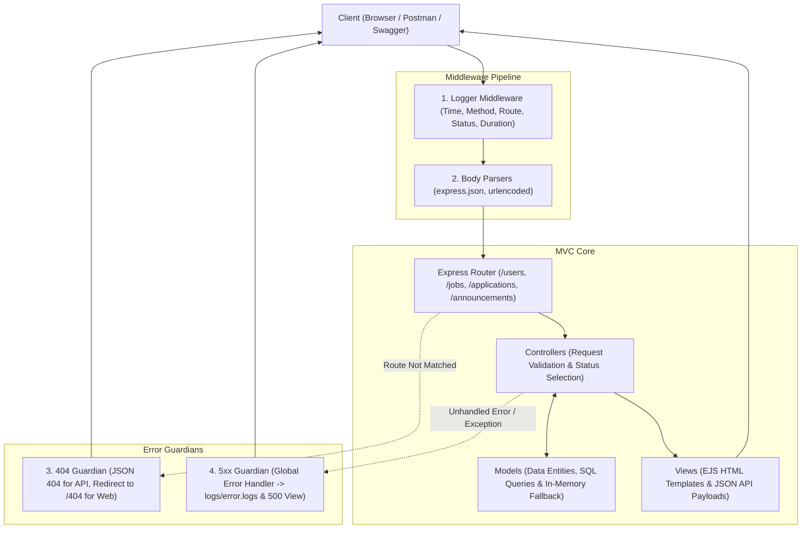
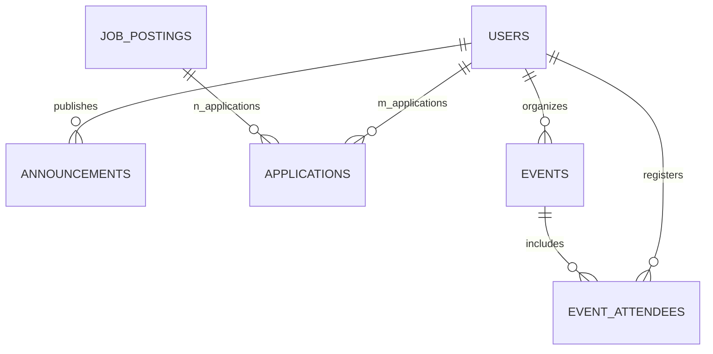

# 🎓 Alumni Tracking & Networking Platform

A scalable, modern web application designed to bridge the gap between academic institutions, active students, and graduates. The platform enables alumni to maintain lifelong connections, track professional growth, share career opportunities, manage job applications, and foster community mentorship.

> 🎨 **Brand & Design:** For visual identity and UI design tokens, see **[brand.md](brand.md)** and **[DESIGN.md](DESIGN.md)** *(RunwayML + Apple aesthetic synthesis)*.  
> 📐 **Data Architecture:** For database schemas and relational integrity, see **[ddd.md](ddd.md)**.

---

## 📚 Core Documentation & Design Standards

The project is governed by three primary source-of-truth documents:

| Document | Focus | Highlights & Links |
| :--- | :--- | :--- |
| 🎨 **[brand.md](brand.md)** | **Brand Identity & Philosophy** | Brand values, soft pastel color palettes, typography scale, pill badges, and tone of voice. |
| 📐 **[DESIGN.md](DESIGN.md)** | **Technical Design System** | Synthesis of **[RunwayML](https://getdesign.md/runwayml/design-md)** (editorial pacing, solid black pills) & **[Apple](https://getdesign.md/apple/design-md)** (frosted-glass navigation, parchment `#F5F5F7`, SF Pro tight typography, museum tiles). |
| 🗄️ **[ddd.md](ddd.md)** | **Data Design Document** | Database schema, foreign key relations, constraints (`UNIQUE(user_id, job_id)`), and controller validations. |

---

## 📌 Features & Modules

### 1. Profile & Member Directory
- **Multi-Role System:** Distinct permission levels and experiences for Administrators, Alumni, and Students.
- **Academic & Professional Data:** Record degrees, graduation years, departments, companies, and roles.
- **Search & Exploration:** Browse members with direct links to published notices and opportunities.

### 2. Career Hub & Job Postings
- **Job & Internship Board:** Alumni and admins can post career opportunities with salary, employment type, and seniority levels.
- **Validation Rules:** Title (required, max 120 chars), company (required), city/location (optional), description (optional).
- **Relational Ownership:** Postings belong to alumni users and receive candidate applications.

### 3. Application Tracking & Evaluation
- **Candidate Submission:** Students and alumni can apply to postings with resumes and cover letters.
- **Many-to-Many (M:N) Relationship:** Users and Job Postings connect via the `applications` junction table.
- **Duplicate Prevention:** Enforces `UNIQUE(user_id, job_id)` constraint (returns `409 Conflict`).
- **Application Statuses:** `Pending`, `Reviewed`, `Interviewing`, `Accepted`, `Rejected`.

### 4. Announcements & Institutional Notices
- Categorized by topic (`General`, `Career`, `Academic`, `Event`, `Scholarship`) with priority tags.

---

## 🛠️ Tech Stack

| Layer | Technology | Description |
| :--- | :--- | :--- |
| **Backend** | Node.js, Express.js | Non-blocking, event-driven RESTful API & Web application |
| **Frontend / Views** | EJS (Embedded JavaScript), CSS3 | Unified, responsive server-rendered interface |
| **Database** | MySQL 8.0 | Relational database with strict schema, foreign keys, and ACID compliance |
| **Containerization** | Docker & Docker Compose | Reproducible, isolated environment running with `docker compose up` |
| **API Docs & Testing**| Swagger UI (OpenAPI 3.0), Postman | Interactive documentation at `/api/swagger` |

---

## 🏛️ System Architecture: MVC & Middleware Pipeline



---

## 🛡️ Enterprise Middleware Suite (Today's Work)

### 1. 📋 Logger Middleware (`middlewares/logger.js`)
Intercepts every incoming HTTP request and outputs a formatted log to the server terminal upon response completion:
```text
time 13:25:32 method POST route /api/users res. type 201 duration 15ms
time 13:25:32 method GET route /ok res. type 200 duration 4ms
time 13:25:32 method GET route /api/nonexistent res. type 404 duration 1ms
```

### 2. 🛡️ 404 Guardian Middleware (`middlewares/notFoundGuardian.js`)
Mounted at the end of all defined routes to gracefully handle unmapped or broken URLs:
* **API Requests (`/api/*`):** Returns structured `404 Not Found` JSON without breaking REST contracts:
  ```json
  {
    "success": false,
    "error": "Not Found",
    "message": "🛡️ 404 Guardian: Aradığınız API rotası bulunamadı -> [GET] /api/unknown",
    "statusCode": 404
  }
  ```
* **Web Browser Requests:** Redirects (`HTTP 302`) to the centralized generic `/404` page.

### 3. 🌐 Generic 404 Error Page (`/404` & `views/404.ejs`)
Dedicated, responsive error page providing feedback on the broken route and clean navigation buttons to return to the home page or go back.

### 4. 🛡️⚡ 5xx Guardian Middleware (`middlewares/serverErrorGuardian.js`)
Express 4-argument global error handler `(err, req, res, next)` catching uncaught server exceptions:
* Prevents process crashes and shields internal credentials and database connection strings from leakage.
* Returns `500 Internal Server Error` JSON for API requests.
* Renders `views/500.ejs` error page for web visitors.

### 5. 📂 Persistent Error Logging (`logs/error.logs`)
Whenever a 5xx error occurs, the 5xx Guardian automatically appends the incident record, timestamp, route, and full stack trace to `logs/error.logs` for audit and post-mortem debugging.

---

## 🔐 Authentication, Session & Role-Based Access Control (RBAC)

The platform features an enterprise-grade authentication and authorization engine built in strict compliance with the **Domain-Driven Design (DDD)** specification.

### 1. Dual-Mode Authentication Architecture
The platform accommodates both traditional browser sessions and stateless API clients:
* **Web UI (Session Cookies):** Upon login (`POST /login`) or registration (`POST /register`), the server issues an encrypted, signed HTTP cookie named `alumni_session` with `HttpOnly: true`, `SameSite: Lax`, and a 7-day expiration.
* **REST API (Bearer Tokens):** API clients authenticate via the standard `Authorization: Bearer <token>` header (`POST /api/auth/login`).
* **Cryptographic Signatures & Password Hashing:** 
  - Sessions and API tokens are signed using **HMAC SHA-256** with base64url encoding, ensuring tamper-proof integrity without external JWT dependencies.
  - Passwords are encrypted using Node.js native `crypto.scryptSync` with unique cryptographic salts.

---

### 2. User Roles & Capabilities Archetype

| Role Archetype | Primary Domain Objectives | Key Permissions & Capabilities |
| :--- | :--- | :--- |
| **`Student`** 📚 | Career discovery & skill advancement | • Browse published jobs and submit applications.<br>• Track personal application stages in real-time.<br>• Restricted from posting jobs or elevating system roles. |
| **`Alumni`** 🎓 | Hiring talent & mentorship | • Publish and manage job openings (`POST /jobs`).<br>• Review candidate submissions for own published listings.<br>• Track applicant pipelines with live candidate counters. |
| **`Admin`** 🛡️ | Governance, moderation & compliance | • Full CRUD governance across `users`, `jobs`, `applications`, and `announcements`.<br>• Elevate or demote user roles (`POST /panel/users/:id/role`).<br>• Access the centralized **Alumni Control Panel** (`/panel`). |

---

### 3. Role-Based Access Control (RBAC) Matrix

| Entity Domain | Operation | Student | Alumni | Admin | Guard Middleware |
| :--- | :--- | :---: | :---: | :---: | :--- |
| **`Authentication`** | Register / Login | ✅ (Guest) | ✅ (Guest) | ✅ (Guest) | `requireGuest` |
| **`Profile`** | Edit Own Profile | ✅ | ✅ | ✅ | `requireAuth`, `requireSelfOrAdmin` |
| | Elevate User Role | ❌ | ❌ | ✅ | `requireAuth`, `requireAdmin` |
| | Delete Account | ❌ | ❌ | ✅ | `requireAuth`, `requireAdmin` |
| **`Jobs`** | Browse Listings | ✅ | ✅ | ✅ | Public |
| | Publish Opening | ❌ | ✅ | ✅ | `requireAuth`, `requireAlumniOrAdmin` |
| | Toggle Active / Delete | ❌ | ✅ (Own) | ✅ (Any) | `requireAuth`, `requireAlumniOrAdmin` |
| **`Applications`** | Submit Application | ✅ | ✅ | ✅ | `requireAuth` |
| | View Own Submissions | ✅ | ✅ | ✅ | `requireAuth`, `requireSelfOrAdmin` |
| | Update Stage (Review) | ❌ | ✅ (Own Jobs) | ✅ (Any) | `requireAuth`, `requireAlumniOrAdmin` |
| **`Announcements`** | Browse Newsroom | ✅ | ✅ | ✅ | Public |
| | Create / Edit / Delete | ❌ | ❌ | ✅ | `requireAuth`, `requireAdmin` |
| **`Governance Panel`**| Access `/panel` | ❌ | ❌ | ✅ | `requireAuth`, `requireAdmin` |

---

### 4. Modular Auth Middleware Suite (`middlewares/authMiddleware.js`)

1. **`sessionMiddleware` (Global Context Injector):**
   Runs on every incoming request. Inspects `req.cookies['alumni_session']` or `Authorization: Bearer <token>`, validates HMAC signature, and populates `req.user` and EJS templates via `res.locals.currentUser`, `res.locals.isAuthenticated`, `res.locals.isAdmin`, `res.locals.isAlumni`, and `res.locals.isStudent`.
2. **`requireAuth` (Authentication Guard):**
   Guards protected endpoints. For web requests, remembers the requested destination and redirects to `/login?returnTo=...`. For API requests, returns `401 Unauthorized` JSON.
3. **`requireGuest` (Guest Guard):**
   Prevents authenticated users from seeing `/login` and `/register`, redirecting them directly to their personal profile (`/users/:id`).
4. **`requireRole(...allowedRoles)` (RBAC Authorization Factory):**
   Validates whether `req.user.role` matches the allowed role set. Rejects unauthorized attempts with `403 Forbidden` JSON (API) or renders the customized Apple-styled [`views/403.ejs`](views/403.ejs) error page (Web).
   - Semantic aliases: `requireAdmin`, `requireAlumniOrAdmin`, `requireStudentOrAdmin`.
5. **`requireSelfOrAdmin(idParamKey)` (Ownership & Privacy Guard):**
   Guarantees that a user can only view or modify their own sensitive resources (such as private job applications or profile attributes), while giving Administrators global oversight.

---

### 5. 🛡️ Alumni Control & Governance Panel (`/panel`)
A dedicated administrative dashboard accessible strictly by `Admin` users:
* **Domain Metrics:** Live breakdown of Students, Alumni, Admins, active job listings, candidate pipelines, and newsroom notices.
* **RBAC Role Registry:** One-click role elevation / demotion (`Student` ➔ `Alumni` ➔ `Admin`) and user pruning.
* **Job Moderation:** Immediate `Active` / `Inactive` publication status toggling.
* **Pipeline Oversight:** Fast-track candidate recruitment stages (`Submitted`, `Reviewed`, `Interview`, `Accepted`, `Rejected`).
* **Instant Announcement Publisher:** Broadcast campus announcements directly from the panel.

---

### 6. 👤 Role-Specific User Profiles & Dynamic Navigation

* **Dynamic Navigation (Navbar):**
  - **Guests:** See `Members`, `Jobs`, `Announcements`, `About`, `Log In`, and `Register`.
  - **Students:** See `Members`, `Jobs`, `Announcements`, `Applications`, `About`, plus user name with blue active indicator.
  - **Alumni:** See `Members`, `Jobs`, `My Postings`, `Applications`, `Announcements`, `API Docs`, plus user name with green active indicator.
  - **Admins:** See all sections plus a purple **`Panel 🛡️`** navigation badge and elevated management controls.
* **Role-Specific Profile Pages (`/users/:id` & `/profile` / `/me`):**
  - **Student View:** Displays live **Application Pipeline Tracker** with real-time stage badges and dossier inspection.
  - **Alumni View:** Displays **Published Opportunities & Candidate Counts** with direct shortcuts to candidate dossiers.
  - **Admin View:** Displays **Governance Station** with shortcuts to platform registries.

---

### 7. 🔑 Pre-Configured Test Credentials

For quick evaluation, the following pre-seeded demo accounts are available:

| Role | Email | Password | Access Highlights |
| :--- | :--- | :--- | :--- |
| **`Admin`** 🛡️ | `sevvalsude@alumni.edu` | `password123` | Full system governance, `/panel` access, role elevation |
| **`Alumni`** 🎓 | `sude@alumni.edu` | `password123` | Post jobs, review applicants, manage listings |
| **`Student`** 📚 | `raphael_ratke39@yahoo.com` | `password123` | Apply to openings, track application stages |

---

## 📊 Core API & Web Endpoint Mapping

| Method | Endpoint | Description | Guard / Protection | Status Codes |
| :--- | :--- | :--- | :--- | :--- |
| `GET` | `/` | Main Unified Dashboard | Public | `200` |
| `GET` | `/login` / `POST /login` | User Authentication (Web Session) | `requireGuest` | `200`, `302`, `401` |
| `GET` | `/register` / `POST /register` | Member Registration (Web UI) | `requireGuest` | `200`, `302`, `400` |
| `GET` | `/logout` / `POST /logout` | End Active Session (Clear Cookie) | Authenticated | `302` |
| `GET` | `/profile` / `/me` | Jump to Current User Profile | `requireAuth` | `302` |
| `GET` | `/panel` | Centralized Alumni Governance Panel | `requireAdmin` | `200`, `403` |
| `POST`| `/panel/users/:id/role` | Elevate / Demote User Role (RBAC) | `requireAdmin` | `200`, `302`, `403` |
| `POST`| `/panel/jobs/:id/toggle` | Toggle Job Active / Inactive Status | `requireAdmin` | `200`, `302`, `403` |
| `POST`| `/panel/applications/:id/status`| Update Candidate Pipeline Stage | `requireAdmin` | `200`, `302`, `403` |
| `POST`| `/api/auth/register` | REST API User Registration | Public | `201`, `400` |
| `POST`| `/api/auth/login` | REST API Login (Issues Bearer Token) | Public | `200`, `401` |
| `POST`| `/api/auth/logout` | REST API Token Revocation | Authenticated | `200` |
| `GET` | `/api/panel/stats` | JSON Analytics for Governance Suite | `requireAdmin` | `200`, `403` |
| `GET` | `/api/health` | Server Health & Diagnostic Check | Public | `200` |
| `GET` | `/users` / `/api/users` | List all members (HTML / JSON) | Public | `200` |
| `GET` | `/users/:id` / `/api/users/:id`| Role-specific member profile | Public | `200`, `404` |
| `GET` | `/users/:id/edit` | Edit member profile form | `requireSelfOrAdmin` | `200`, `403` |
| `POST`| `/users/:id/update` | Update member attributes | `requireSelfOrAdmin` | `302`, `403` |
| `GET` | `/users/:id/applications` | User's private job submissions | `requireSelfOrAdmin` | `200`, `403` |
| `GET` | `/users/:id/jobs` | User's published job opportunities | Public | `200`, `404` |
| `GET` | `/jobs` / `/api/jobs` | Browse career opportunities | Public | `200` |
| `GET` | `/jobs/:id` / `/api/jobs/:id` | View job details & requirements | Public | `200`, `404` |
| `POST`| `/jobs` / `/api/jobs` | Publish a new job opportunity | `requireAlumniOrAdmin` | `201`, `403` |
| `GET` | `/jobs/:id/applications` | Review applicants of a posting | Public / Protected | `200`, `404` |
| `GET` | `/applications` / `/api/applications` | Applications pipeline view | `requireAuth` | `200`, `401` |
| `POST`| `/applications` | Apply for an open position | `requireAuth` | `302`, `401`, `409` |
| `GET` | `/announcements` | Institutional announcements board | Public | `200` |
| `POST`| `/announcements` | Publish campus announcement | `requireAdmin` | `302`, `403` |
| `GET` | `/404` | Generic 404 Not Found Page | Public | `404` |
| `GET` | `/api/swagger` | OpenAPI Interactive Documentation | Public | `200` |

---

## 🗄️ Data Design Documentation (DDD)

Comprehensive database architecture, relational entity diagrams, constraints, and validation rules are documented in **[`ddd.md`](ddd.md)**.

### Entity-Relationship Architecture (M:N via Junction Table)

> **Rule:** `USERS` and `JOB_POSTINGS` are **never directly connected**. They connect strictly through the **`APPLICATIONS` junction table** ($M:N$).

---

## 📂 Project Structure

```text
alumni/
├── config/                   # Database pool & connection configuration
│   └── db.js                        # MySQL2 connection pool with offline fallback
├── controllers/              # Application logic & HTTP status orchestrators
│   ├── authController.js            # Authentication, registration & session controller
│   ├── panelController.js           # Centralized Alumni & Admin Governance Panel
│   ├── apiUserController.js         # REST API controller for users
│   ├── userController.js            # Web HTML controller for users
│   ├── apiJobPostingController.js   # REST API controller for job postings
│   ├── jobPostingController.js      # Web HTML controller for job postings
│   ├── apiApplicationController.js  # REST API controller for applications
│   ├── applicationController.js     # Web HTML controller for applications
│   ├── apiAnnouncementController.js # REST API controller for announcements
│   └── announcementController.js    # Web HTML controller for announcements
├── factories/                # Mock data generators (faker-js)
│   ├── userFactory.js               # User seed factory
│   ├── announcementFactory.js       # Announcement seed factory
│   └── jobPostingFactory.js         # Job posting seed factory
├── logs/                     # Persistent system and error archives
│   └── error.logs                   # Archived 5xx error logs with stack traces
├── middlewares/              # Express custom middleware suite
│   ├── authMiddleware.js            # Authentication & RBAC role guards (Session, Auth, Admin)
│   ├── logger.js                    # Terminal request-duration logger middleware
│   ├── notFoundGuardian.js          # 404 Guardian (JSON 404 & Web redirect)
│   └── serverErrorGuardian.js       # 5xx Guardian global error handler
├── migrations/               # Sequential SQL schema migrations
│   ├── 001_create_users_table.sql
│   ├── 002_create_announcements_table.sql
│   ├── 003_seed_initial_data.sql
│   ├── 004_create_job_postings_table.sql
│   ├── 005_create_applications_table.sql
│   └── 006_seed_job_postings.sql
├── models/                   # Data access layer & business rule validation
│   ├── userModel.js                 # User entity, password hash & relationships
│   ├── announcementModel.js         # Announcement entity
│   ├── jobPostingModel.js           # Job posting entity & relationships
│   └── applicationModel.js          # Application entity & constraints
├── routes/                   # Modular route declarations
│   ├── apiUserRoutes.js             # /api/users
│   ├── userRoutes.js                # /users
│   ├── apiJobPostingRoutes.js       # /api/jobs
│   ├── jobPostingRoutes.js          # /jobs
│   ├── apiApplicationRoutes.js      # /api/applications
│   ├── applicationRoutes.js         # /applications
│   ├── apiAnnouncementRoutes.js     # /api/announcements
│   └── announcementRoutes.js        # /announcements
├── views/                    # EJS dynamic HTML templates
│   ├── partials/                    # Shared reusable design components
│   │   ├── head.ejs                 # Shared tokens, typography & responsive styles
│   │   ├── navbar.ejs               # Dynamic role-based sticky navigation
│   │   └── footer.ejs               # Apple parchment footer
│   ├── index.ejs                    # Modern Apple & RunwayML homepage dashboard
│   ├── login.ejs                    # Apple minimalist sign in portal
│   ├── register.ejs                 # Segmented role registration portal
│   ├── panel.ejs                    # Centralized Alumni & Admin Governance Panel
│   ├── 403.ejs                      # 403 Forbidden RBAC access error view
│   ├── 404.ejs                      # 404 Guardian error page
│   ├── 500.ejs                      # 500 Server Error Guardian page
│   ├── users.ejs & userDetail.ejs   # User directory and role-specific profile views
│   ├── userEdit.ejs                 # User profile edit form with role lock
│   ├── jobs.ejs & jobDetail.ejs     # Job list and detail with quick-apply
│   ├── applications.ejs             # Application pipeline view
│   ├── applicationDetail.ejs        # Application review & status view
│   ├── announcements.ejs            # Announcements board view
│   └── announcementDetail.ejs       # Announcement detail view
├── scripts/                  # Database management scripts
│   ├── migrate.js                   # Automated migration runner
│   └── seed.js                      # Database seeder with factory integration
├── .env.example              # Public template for environment configuration
├── brand.md                  # Brand identity, typography & guidelines (see brand.md)
├── DESIGN.md                 # Design system tokens (RunwayML + Apple, see DESIGN.md)
├── ddd.md                    # Data Design Documentation (Source of Truth, see ddd.md)
├── docker-compose.yml        # Docker compose container setup
├── Dockerfile                # Docker image specification
├── package.json              # Project dependencies & scripts
├── server.js                 # Application bootstrap & middleware pipeline
└── README.md                 # Project guide & architecture documentation
```

---

## 🚀 Getting Started

To spin up the entire system from scratch on any machine:

1. **Clone the repository:**
   ```bash
   git clone https://github.com/sevvalsudet/alumni.git
   cd alumni
   ```

2. **Configure environment variables:**
   ```bash
   cp .env.example .env
   ```

3. **Start with Docker Compose:**
   ```bash
   docker compose up --build
   ```

4. **Run migrations and seed data:**
   ```bash
   docker compose exec app npm run migrate
   docker compose exec app npm run seed
   ```

5. **Access the application:**
   - **Web UI:** [http://localhost:3000](http://localhost:3000)
   - **Interactive API Docs (Swagger):** [http://localhost:3000/api/swagger](http://localhost:3000/api/swagger)
   - **Health Check:** [http://localhost:3000/api/health](http://localhost:3000/api/health)

---

## 📄 License
This project is licensed under the [MIT License](LICENSE).
