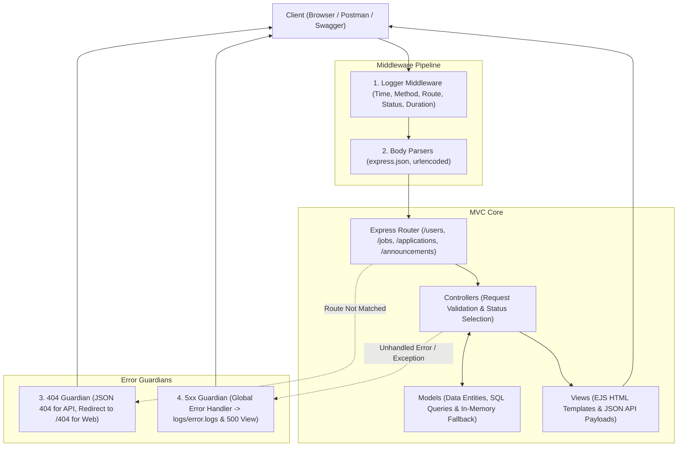
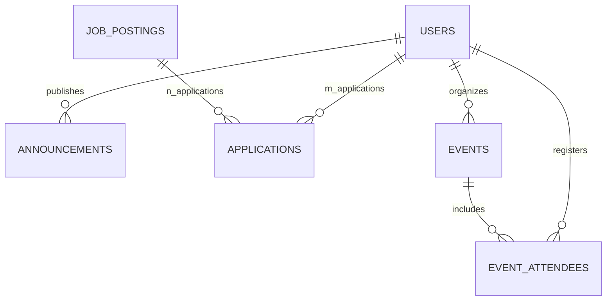

# 🎓 Alumni Tracking & Networking Platform

A scalable, modern web application designed to bridge the gap between academic institutions, active students, and graduates. The platform enables alumni to maintain lifelong connections, track professional growth, share career opportunities, manage job applications, and foster community mentorship.

---

## 📌 Features & Modules

### 1. Profile & Member Directory
- **Multi-Role System:** Distinct permission levels and experiences for Administrators, Alumni, and Students.
- **Academic & Professional Data:** Record degrees, graduation years, departments, companies, and roles.
- **Search & Exploration:** Browse members with direct links to published notices and opportunities.

### 2. Career Hub & Job Postings
- **Job & Internship Board:** Alumni and admins can post career opportunities with salary, employment type, and seniority levels.
- **Validation Rules:** Title (required, max 120 chars), company (required), city/location (optional), description (optional).
- **Relational Ownership:** Postings belong to alumni users and receive candidate applications.

### 3. Application Tracking & Evaluation
- **Candidate Submission:** Students and alumni can apply to postings with resumes and cover letters.
- **Many-to-Many (M:N) Relationship:** Users and Job Postings connect via the `applications` junction table.
- **Duplicate Prevention:** Enforces `UNIQUE(user_id, job_id)` constraint (returns `409 Conflict`).
- **Application Statuses:** `Pending`, `Reviewed`, `Interviewing`, `Accepted`, `Rejected`.

### 4. Announcements & Institutional Notices
- Categorized by topic (`General`, `Career`, `Academic`, `Event`, `Scholarship`) with priority tags.

---

## 🛠️ Tech Stack

| Layer | Technology | Description |
| :--- | :--- | :--- |
| **Backend** | Node.js, Express.js | Non-blocking, event-driven RESTful API & Web application |
| **Frontend / Views** | EJS (Embedded JavaScript), CSS3 | Unified, responsive server-rendered interface |
| **Database** | MySQL 8.0 | Relational database with strict schema, foreign keys, and ACID compliance |
| **Containerization** | Docker & Docker Compose | Reproducible, isolated environment running with `docker compose up` |
| **API Docs & Testing**| Swagger UI (OpenAPI 3.0), Postman | Interactive documentation at `/api/swagger` |

---

## 🏛️ System Architecture: MVC & Middleware Pipeline



---

## 🛡️ Enterprise Middleware Suite (Today's Work)

### 1. 📋 Logger Middleware (`middlewares/logger.js`)
Intercepts every incoming HTTP request and outputs a formatted log to the server terminal upon response completion:
```text
time 13:25:32 method POST route /api/users res. type 201 duration 15ms
time 13:25:32 method GET route /ok res. type 200 duration 4ms
time 13:25:32 method GET route /api/nonexistent res. type 404 duration 1ms
```

### 2. 🛡️ 404 Guardian Middleware (`middlewares/notFoundGuardian.js`)
Mounted at the end of all defined routes to gracefully handle unmapped or broken URLs:
* **API Requests (`/api/*`):** Returns structured `404 Not Found` JSON without breaking REST contracts:
  ```json
  {
    "success": false,
    "error": "Not Found",
    "message": "🛡️ 404 Guardian: Aradığınız API rotası bulunamadı -> [GET] /api/unknown",
    "statusCode": 404
  }
  ```
* **Web Browser Requests:** Redirects (`HTTP 302`) to the centralized generic `/404` page.

### 3. 🌐 Generic 404 Error Page (`/404` & `views/404.ejs`)
Dedicated, responsive error page providing feedback on the broken route and clean navigation buttons to return to the home page or go back.

### 4. 🛡️⚡ 5xx Guardian Middleware (`middlewares/serverErrorGuardian.js`)
Express 4-argument global error handler `(err, req, res, next)` catching uncaught server exceptions:
* Prevents process crashes and shields internal credentials and database connection strings from leakage.
* Returns `500 Internal Server Error` JSON for API requests.
* Renders `views/500.ejs` error page for web visitors.

### 5. 📂 Persistent Error Logging (`logs/error.logs`)
Whenever a 5xx error occurs, the 5xx Guardian automatically appends the incident record, timestamp, route, and full stack trace to `logs/error.logs` for audit and post-mortem debugging.

---

## 📊 Core API & Web Endpoint Mapping

| Method | Endpoint | Description | Status Codes |
| :--- | :--- | :--- | :--- |
| `GET` | `/` | Main Unified Dashboard | `200` |
| `GET` | `/api/health` | Server Health & Diagnostic Check | `200` |
| `GET` | `/users` / `/api/users` | List all members (HTML / JSON) | `200` |
| `GET` | `/api/users/:id` | Get user by ID (supports `?include=jobs`) | `200`, `404` |
| `POST`| `/api/users` | Register a new member | `201`, `400` |
| `GET` | `/jobs` / `/api/jobs` | Browse career opportunities | `200` |
| `GET` | `/jobs/:id` / `/api/jobs/:id` | View job details (supports `?include=users`) | `200`, `404` |
| `POST`| `/jobs` / `/api/jobs` | Publish a new job opportunity | `201`, `400` |
| `GET` | `/api/users/:id/jobs` | M:N applied jobs of a user | `200`, `404` |
| `GET` | `/api/jobs/:id/users` | M:N applicants of a job posting | `200`, `404` |
| `GET` | `/applications` / `/api/applications` | List applications (filterable by job/user) | `200` |
| `POST`| `/api/jobs/:id/applications` | Apply for a position | `201`, `400`, `404`, `409` |
| `PATCH`| `/api/applications/:id` | Update candidate review status | `200`, `404` |
| `GET` | `/404` | Generic 404 Not Found Page | `404` |
| `GET` | `/api/swagger` | OpenAPI Interactive Documentation | `200` |

---

## 🗄️ Data Design Documentation (DDD)

Comprehensive database architecture, relational entity diagrams, constraints, and validation rules are documented in **[`ddd.md`](ddd.md)**.

### Entity-Relationship Architecture (M:N via Junction Table)

> **Rule:** `USERS` and `JOB_POSTINGS` are **never directly connected**. They connect strictly through the **`APPLICATIONS` junction table** ($M:N$).

---

## 📂 Project Structure

```text
alumni/
├── config/                   # Database pool & connection configuration
│   └── db.js                        # MySQL2 connection pool with offline fallback
├── controllers/              # Application logic & HTTP status orchestrators
│   ├── apiUserController.js         # REST API controller for users
│   ├── userController.js            # Web HTML controller for users
│   ├── apiJobPostingController.js   # REST API controller for job postings
│   ├── jobPostingController.js      # Web HTML controller for job postings
│   ├── apiApplicationController.js  # REST API controller for applications
│   ├── applicationController.js     # Web HTML controller for applications
│   ├── apiAnnouncementController.js # REST API controller for announcements
│   └── announcementController.js    # Web HTML controller for announcements
├── factories/                # Mock data generators (faker-js)
│   ├── userFactory.js               # User seed factory
│   ├── announcementFactory.js       # Announcement seed factory
│   └── jobPostingFactory.js         # Job posting seed factory
├── logs/                     # Persistent system and error archives
│   └── error.logs                   # Archived 5xx error logs with stack traces
├── middlewares/              # Express custom middleware suite
│   ├── logger.js                    # Terminal request-duration logger middleware
│   ├── notFoundGuardian.js          # 404 Guardian (JSON 404 & Web redirect)
│   └── serverErrorGuardian.js       # 5xx Guardian global error handler
├── migrations/               # Sequential SQL schema migrations
│   ├── 001_create_users_table.sql
│   ├── 002_create_announcements_table.sql
│   ├── 003_seed_initial_data.sql
│   ├── 004_create_job_postings_table.sql
│   ├── 005_create_applications_table.sql
│   └── 006_seed_job_postings.sql
├── models/                   # Data access layer & business rule validation
│   ├── userModel.js                 # User entity & relationships
│   ├── announcementModel.js         # Announcement entity
│   ├── jobPostingModel.js           # Job posting entity & relationships
│   └── applicationModel.js          # Application entity & constraints
├── routes/                   # Modular route declarations
│   ├── apiUserRoutes.js             # /api/users
│   ├── userRoutes.js                # /users
│   ├── apiJobPostingRoutes.js       # /api/jobs
│   ├── jobPostingRoutes.js          # /jobs
│   ├── apiApplicationRoutes.js      # /api/applications
│   ├── applicationRoutes.js         # /applications
│   ├── apiAnnouncementRoutes.js     # /api/announcements
│   └── announcementRoutes.js        # /announcements
├── views/                    # EJS dynamic HTML templates
│   ├── 404.ejs                      # Generic 404 Not Found error page
│   ├── 500.ejs                      # 500 Internal Server Error page
│   ├── users.ejs & userDetail.ejs   # User list and profile views
│   ├── jobs.ejs & jobDetail.ejs     # Job list and detail with quick-apply
│   ├── applications.ejs             # Application management view
│   ├── applicationDetail.ejs        # Application review & status view
│   └── announcements.ejs            # Announcements board view
├── scripts/                  # Database management scripts
│   ├── migrate.js                   # Automated migration runner
│   └── seed.js                      # Database seeder with factory integration
├── .env.example              # Public template for environment configuration
├── ddd.md                    # Data Design Documentation (Source of Truth)
├── docker-compose.yml        # Docker compose container setup
├── Dockerfile                # Docker image specification
├── package.json              # Project dependencies & scripts
├── server.js                 # Application bootstrap & middleware pipeline
└── README.md                 # Project guide & architecture documentation
```

---

## 🚀 Getting Started

To spin up the entire system from scratch on any machine:

1. **Clone the repository:**
   ```bash
   git clone https://github.com/sevvalsudet/alumni.git
   cd alumni
   ```

2. **Configure environment variables:**
   ```bash
   cp .env.example .env
   ```

3. **Start with Docker Compose:**
   ```bash
   docker compose up --build
   ```

4. **Run migrations and seed data:**
   ```bash
   docker compose exec app npm run migrate
   docker compose exec app npm run seed
   ```

5. **Access the application:**
   - **Web UI:** [http://localhost:3000](http://localhost:3000)
   - **Interactive API Docs (Swagger):** [http://localhost:3000/api/swagger](http://localhost:3000/api/swagger)
   - **Health Check:** [http://localhost:3000/api/health](http://localhost:3000/api/health)

---

## 📄 License
This project is licensed under the [MIT License](LICENSE).
