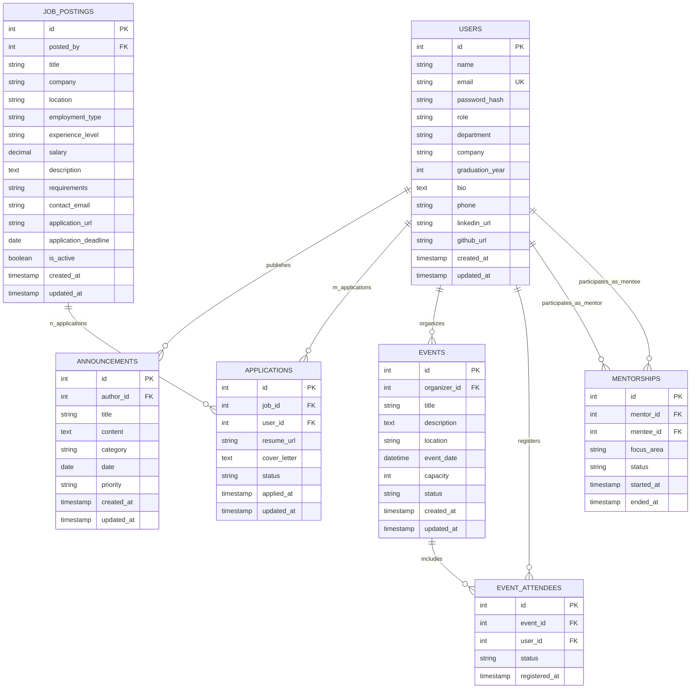

# 📊 Data Design Documentation (DDD)

## 1. Executive Summary & Purpose

The **Data Design Document (DDD)** specifies the conceptual, logical, and physical data architecture for the **Alumni Tracking & Networking Platform**. It defines entity definitions, structural schemas, integrity constraints, relationship cardinalities, and data management strategies required to transition the application from an in-memory prototype to a fully normalized, enterprise-grade relational database.

---

## 2. Conceptual Data Model

The platform centers around verified academic and professional connections between university graduates, faculty, and active students. The conceptual model organizes platform operations into five primary domains:

1. **Identity & Member Domain:** Represents system users, credentials, roles, and profile metadata.
2. **Communication & Announcements Domain:** Manages university-wide and departmental notices, announcements, and categorization.
3. **Career & Opportunity Domain:** Facilitates job and internship listings posted by alumni for graduates and students.
4. **Community & Events Domain:** Tracks alumni gatherings, reunions, conferences, webinars, and attendance rosters.
5. **Mentorship & Networking Domain:** Manages peer-to-peer mentorship pairings and direct messaging connections.

---

## 3. Entity-Relationship Diagram (ERD)

> [!IMPORTANT]
> **Many-to-Many (M:N) Relationship: User (m) ↔ applications ↔ (n) Job-Postings**
> - `User` ve `Job-Postings` varlıkları arasında **DOĞRUDAN** bir ilişki bulunmamaktadır.
> - İki varlık birbirine **`applications` (Junction / Köprü)** tablosu üzerinden bağlanır.
> - `GET /api/users/1` sorgusunda `User.find(1, { include: 'jobs' })` yapıldığında veya `/api/users/1/jobs` çağrıldığında, `applications` köprü tablosu üzerinden kullanıcının başvurduğu iş ilanları listelenir.

---

## 4. Logical & Physical Data Dictionary

### 4.1. `users` Table
Stores authentication credentials, core attributes, and academic/professional background.

| Column | Data Type | Constraints | Description |
| :--- | :--- | :--- | :--- |
| `id` | `INT` | `PRIMARY KEY`, `AUTO_INCREMENT` | Unique member identifier |
| `name` | `VARCHAR(100)` | `NOT NULL` | Full legal name |
| `email` | `VARCHAR(150)` | `NOT NULL`, `UNIQUE` | Unique institutional/contact email |
| `password_hash`| `VARCHAR(255)` | `NOT NULL` | Bcrypt salted hash |
| `role` | `ENUM('Admin', 'Alumni', 'Student')` | `NOT NULL`, `DEFAULT 'Alumni'` | Access control role |
| `department` | `VARCHAR(100)` | `NOT NULL` | Academic department / faculty |
| `company` | `VARCHAR(150)` | `NULL` | Current employer or organization |
| `graduation_year`| `SMALLINT` | `NULL` | Year of degree completion |
| `bio` | `TEXT` | `NULL` | Professional biography |
| `phone` | `VARCHAR(20)` | `NULL` | Contact telephone number |
| `linkedin_url` | `VARCHAR(255)` | `NULL` | LinkedIn profile address |
| `github_url` | `VARCHAR(255)` | `NULL` | GitHub / portfolio link |
| `created_at` | `TIMESTAMP` | `DEFAULT CURRENT_TIMESTAMP` | Record creation timestamp |
| `updated_at` | `TIMESTAMP` | `DEFAULT CURRENT_TIMESTAMP ON UPDATE CURRENT_TIMESTAMP` | Last modification timestamp |

---

### 4.2. `announcements` Table
Stores public and institutional notices, categorized by topic.

| Column | Data Type | Constraints | Description |
| :--- | :--- | :--- | :--- |
| `id` | `INT` | `PRIMARY KEY`, `AUTO_INCREMENT` | Unique announcement identifier |
| `author_id` | `INT` | `NOT NULL`, `FOREIGN KEY (users.id)` | ID of the author/admin |
| `title` | `VARCHAR(200)` | `NOT NULL` | Headline or subject |
| `content` | `TEXT` | `NOT NULL` | Full announcement text |
| `category` | `ENUM('General', 'Event', 'Scholarship', 'Career', 'Academic')` | `NOT NULL`, `DEFAULT 'General'` | Classification tag |
| `date` | `DATE` | `NOT NULL` | Publishing or effective date |
| `priority` | `ENUM('Low', 'Normal', 'High', 'Urgent')` | `NOT NULL`, `DEFAULT 'Normal'` | Notice priority level |
| `created_at` | `TIMESTAMP` | `DEFAULT CURRENT_TIMESTAMP` | Record creation timestamp |
| `updated_at` | `TIMESTAMP` | `DEFAULT CURRENT_TIMESTAMP ON UPDATE CURRENT_TIMESTAMP` | Last modification timestamp |

---

### 4.3. `job_postings` Table
Maintains career, job, and internship opportunities submitted by alumni, administrators, and partner organizations.

| Column | Data Type | Constraints | Description |
| :--- | :--- | :--- | :--- |
| `id` | `INT` | `PRIMARY KEY`, `AUTO_INCREMENT` | Unique listing identifier |
| `posted_by` | `INT` | `NOT NULL`, `FOREIGN KEY (users.id) ON DELETE CASCADE` | Submitting alumnus or administrator ID |
| `title` | `VARCHAR(150)` | `NOT NULL` | Job role title (e.g., 'Backend Software Engineer') |
| `company` | `VARCHAR(150)` | `NOT NULL` | Hiring organization or enterprise name |
| `location` | `VARCHAR(100)` | `NOT NULL` | Geographic location (e.g., 'Istanbul, TR', 'Remote') |
| `employment_type`| `ENUM('Full-time', 'Part-time', 'Contract', 'Internship', 'Remote')` | `NOT NULL`, `DEFAULT 'Full-time'` | Employment contract classification |
| `experience_level`| `ENUM('Entry-level', 'Mid-level', 'Senior', 'Lead', 'Executive')` | `NOT NULL`, `DEFAULT 'Entry-level'` | Target professional seniority level |
| `salary` | `DECIMAL(10,2)` | `NULL` | Proposed salary or compensation figure |
| `description` | `TEXT` | `NOT NULL` | Comprehensive role overview and core responsibilities |
| `requirements` | `TEXT` | `NULL` | Technical prerequisites, qualifications, and skills |
| `contact_email` | `VARCHAR(150)` | `NULL` | Inquiring/recruiter contact email address |
| `application_url`| `VARCHAR(255)`| `NULL` | Direct external application portal or form link |
| `application_deadline` | `DATE` | `NULL` | Final acceptance date for submissions |
| `is_active` | `BOOLEAN` | `NOT NULL`, `DEFAULT TRUE` | Active visibility flag for the job listing |
| `created_at` | `TIMESTAMP` | `DEFAULT CURRENT_TIMESTAMP` | Publication timestamp |
| `updated_at` | `TIMESTAMP` | `DEFAULT CURRENT_TIMESTAMP ON UPDATE CURRENT_TIMESTAMP` | Last modification timestamp |

### 4.4. `applications` Table
Tracks job and internship applications submitted by alumni and students for listed opportunities.

| Column | Data Type | Constraints | Description |
| :--- | :--- | :--- | :--- |
| `id` | `INT` | `PRIMARY KEY`, `AUTO_INCREMENT` | Unique application identifier |
| `job_id` | `INT` | `NOT NULL`, `FOREIGN KEY (job_postings.id) ON DELETE CASCADE` | Associated job listing |
| `user_id` | `INT` | `NOT NULL`, `FOREIGN KEY (users.id) ON DELETE CASCADE` | Applicant user identifier |
| `resume_url` | `VARCHAR(255)` | `NULL` | Link or storage path to applicant resume/CV document |
| `cover_letter` | `TEXT` | `NULL` | Personal statement or letter of motivation |
| `status` | `ENUM('Pending', 'Reviewed', 'Interviewing', 'Accepted', 'Rejected')` | `NOT NULL`, `DEFAULT 'Pending'` | Review lifecycle status |
| `applied_at` | `TIMESTAMP` | `DEFAULT CURRENT_TIMESTAMP` | Initial submission timestamp |
| `updated_at` | `TIMESTAMP` | `DEFAULT CURRENT_TIMESTAMP ON UPDATE CURRENT_TIMESTAMP` | Last status or review change timestamp |

*Composite Unique Constraint:* `UNIQUE KEY uk_user_job (user_id, job_id)` prevents candidate duplication per job posting.

---

### 4.5. `events` Table
Tracks alumni reunions, seminars, networking webinars, and workshops.

| Column | Data Type | Constraints | Description |
| :--- | :--- | :--- | :--- |
| `id` | `INT` | `PRIMARY KEY`, `AUTO_INCREMENT` | Unique event identifier |
| `organizer_id` | `INT` | `NOT NULL`, `FOREIGN KEY (users.id)` | Event host or admin |
| `title` | `VARCHAR(150)` | `NOT NULL` | Name of the event |
| `description` | `TEXT` | `NOT NULL` | Detailed event agenda |
| `location` | `VARCHAR(200)` | `NOT NULL` | Physical venue or virtual meeting link |
| `event_date` | `DATETIME` | `NOT NULL` | Scheduled date and start time |
| `capacity` | `INT` | `NULL` | Maximum allowed participants |
| `status` | `ENUM('Draft', 'Published', 'Cancelled', 'Completed')` | `NOT NULL`, `DEFAULT 'Published'` | Event lifecycle status |
| `created_at` | `TIMESTAMP` | `DEFAULT CURRENT_TIMESTAMP` | Record creation timestamp |
| `updated_at` | `TIMESTAMP` | `DEFAULT CURRENT_TIMESTAMP ON UPDATE CURRENT_TIMESTAMP` | Update timestamp |

---

### 4.6. `event_attendees` Table
Associative junction table establishing the many-to-many relationship between members and events.

| Column | Data Type | Constraints | Description |
| :--- | :--- | :--- | :--- |
| `id` | `INT` | `PRIMARY KEY`, `AUTO_INCREMENT` | Unique registration identifier |
| `event_id` | `INT` | `NOT NULL`, `FOREIGN KEY (events.id) ON DELETE CASCADE` | Associated event |
| `user_id` | `INT` | `NOT NULL`, `FOREIGN KEY (users.id) ON DELETE CASCADE` | Registered member |
| `status` | `ENUM('Registered', 'Attended', 'Cancelled')` | `NOT NULL`, `DEFAULT 'Registered'` | RSVP status |
| `registered_at`| `TIMESTAMP` | `DEFAULT CURRENT_TIMESTAMP` | Registration timestamp |

*Composite Unique Constraint:* `UNIQUE KEY (event_id, user_id)` prevents duplicate event registrations.

---

### 4.7. `mentorships` Table
Pairs experienced alumni mentors with students or early-career graduates.

| Column | Data Type | Constraints | Description |
| :--- | :--- | :--- | :--- |
| `id` | `INT` | `PRIMARY KEY`, `AUTO_INCREMENT` | Unique mentorship pair identifier |
| `mentor_id` | `INT` | `NOT NULL`, `FOREIGN KEY (users.id)` | Senior alumnus mentor |
| `mentee_id` | `INT` | `NOT NULL`, `FOREIGN KEY (users.id)` | Student or junior mentee |
| `focus_area` | `VARCHAR(100)` | `NOT NULL` | Discipline (e.g., Software Engineering) |
| `status` | `ENUM('Pending', 'Active', 'Completed', 'Terminated')` | `NOT NULL`, `DEFAULT 'Pending'` | Lifecycle state |
| `started_at` | `TIMESTAMP` | `NULL` | Commencement timestamp |
| `ended_at` | `TIMESTAMP` | `NULL` | Conclusion timestamp |

---

## 5. Normalization & Integrity Rules

1. **Third Normal Form (3NF) Compliance:**
   - Every non-key attribute depends strictly on the primary key, the whole key, and nothing but the key.
   - Eliminates transitive dependencies (e.g., department and company information are tied directly to user entities).
2. **Referential Integrity:**
   - Foreign keys enforce parent-child integrity (`ON DELETE CASCADE` on applications and event registrations, `ON DELETE RESTRICT` on author/organizer relationships).
3. **Data Indexing Strategy:**
   - `users.email`: Unique B-Tree index for \(O(1)\) lookup during authentication.
   - `users.role`, `users.department`: Standard indexes for directory filtering.
   - `announcements.category`, `announcements.date`: Composite index for reverse-chronological filtered queries.
   - `job_postings.is_active`, `job_postings.application_deadline`: Composite index for active job search filtering.
   - `job_postings.posted_by`: Foreign key index for member submission lookup.
   - `applications.job_id`, `applications.user_id`: Foreign key indexes for rapid candidate and application lookup.
   - `applications.status`: Index for review status filtering.
   - `events.event_date`: Index for upcoming schedule timeline retrieval.

---

## 6. Storage & Persistence Architecture

- **In-Memory Phase (Development Baseline):**
  Initial CRUD functionality utilized transient in-memory arrays within Node.js controllers to validate business logic and routing patterns.
- **Relational Persistence (Target Architecture):**
  Persistent data is stored in **MySQL / PostgreSQL** managed within an isolated Docker service.
- **Docker Volume Mapping:**
  Ensures data persists across container lifecycles (`docker compose down` and `docker compose up`) via named volumes (`db_data:/var/lib/mysql`).
